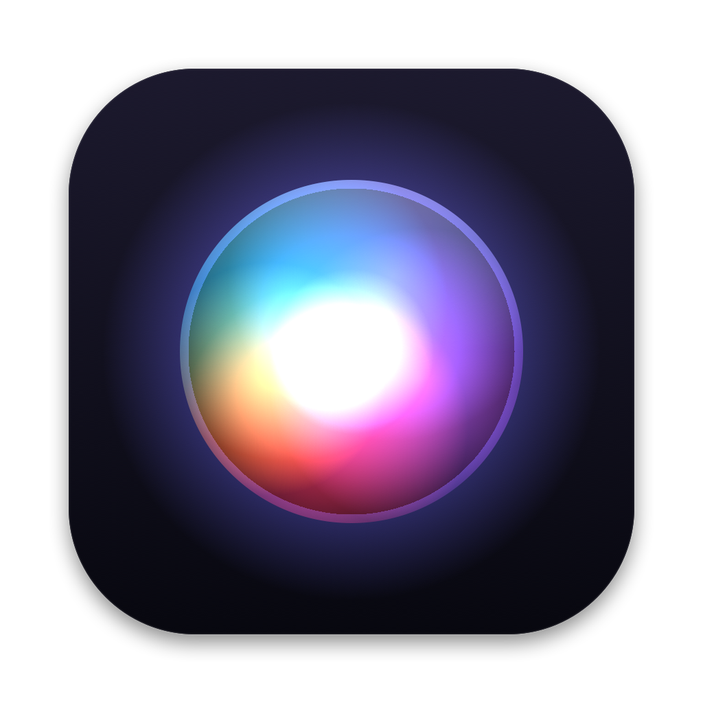
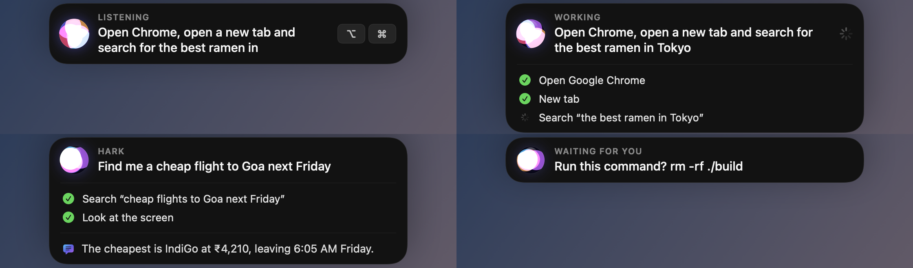
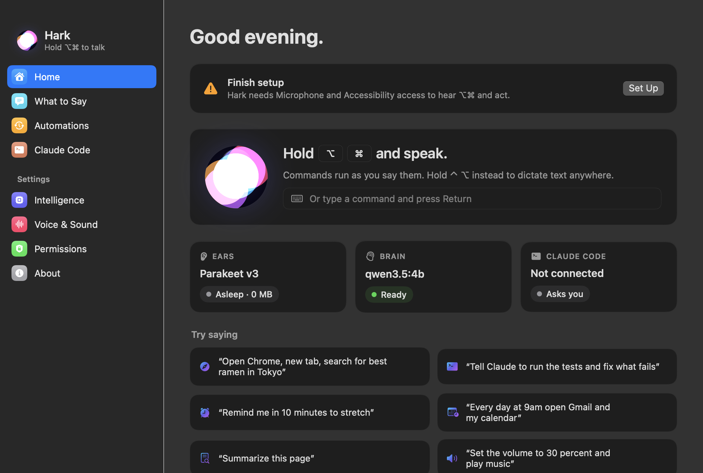

<p align="center">
  
</p>

<h1 align="center">Hark</h1>

<p align="center">
  <b>Your Mac, by voice.</b> Hold <kbd>⌥</kbd><kbd>⌘</kbd>, say what you want, and Hark does it — and shows you what it did.<br>
  Private by design: speech recognition and reasoning run entirely on your Mac.
</p>

<p align="center">
  
</p>

---

## What it does

- **Push-to-talk, anywhere.** Hold <kbd>⌥</kbd><kbd>⌘</kbd> in any app. Release to finish. Or tap <kbd>⌥</kbd><kbd>⌘</kbd> once for hands-free: Hark keeps listening and acting, request after request, until you tap again. Hold <kbd>⌃</kbd><kbd>⌥</kbd> to dictate text into whatever field is focused.
- **Acts while you're still talking.** “Open Chrome… new tab… search for the best ramen in Tokyo” — Chrome opens after the first pause, not after you finish.
- **Writes like dictation.** “Type how are you … new paragraph … I’m fine” types the text and the breaks. While writing, “new line”, “go to a new paragraph” or “in the next line” are formatting, “uh/um” are dropped, and anything that starts like a command (“delete that word”) is done, not typed.
- **Hears through noise.** Apple's voice isolation cleans the mic, then NVIDIA Parakeet (on the Neural Engine) transcribes. A 10-second sentence takes under a second.
- **Instant for the common stuff, smart for the rest.** A rule-based parser handles apps, tabs, search, typing, keys, clicks, scrolling, volume, media, dark mode, reminders — with zero model latency. Anything else goes to the brain: **Claude through the Claude Code CLI you're signed in to** (no API key, no extra cost, ~3 s, remembers the conversation). The brain sees your screen and Hark's tools and answers with a JSON plan that Hark executes, looping when it needs to look at results.
- **Sees your screen.** Claude gets a screenshot plus the front window's Accessibility tree, the current browser tab via AppleScript, and on-device OCR as a fallback.
- **Knows what you're pointing at.** Say “what's in this section?” or “summarize what's around my cursor” — Hark outlines the area under the pointer and sends Claude a close-up of it, its text, and any selection.
- **Quiet by design.** Answers, reminders, and alerts appear on the floating island as text — never spoken. Long answers scroll instead of being cut off; reminders and alerts stay until you close them.
- **Watch anything on screen.** Point with the mouse and say “if this changes, click Yes” — Hark outlines the area under your cursor, links it to that app, and acts the moment it changes. Or “whenever *hello* appears in Notes, say OK”, “when I write *urgent* anywhere, alert me”. Checks are cheap (Accessibility text or a 32×32 thumbnail, about once a second); clicks stay inside the watched area and say nothing if there's nothing to click.
- **Automations on events.** “Every day at 9am open Gmail”, “in 10 minutes remind me to stretch”, “whenever a PDF lands in Downloads, move it to Documents”. The brain only wakes when one fires.
- **Claude Code co-pilot.** “Tell Claude to run the tests and fix what fails” types into the Claude Code session in front of you. Want hands-free approvals? Point at its panel and say “when it asks for permission, click Yes”.
- **Asleep until needed.** The speech model loads on demand and unloads when idle; the brain runs in Claude. At rest Hark uses ~0% CPU and ~300 MB.

<p align="center">
  
</p>

## Requirements

- Apple Silicon Mac, macOS 14 Sonoma or later
- Xcode 15.4+ command-line tools (Swift 5.10)
- ~1 GB disk for speech models
- [Claude Code](https://claude.com/claude-code), signed in with your Claude account (it is Hark's brain — no API key needed)

## Quick start

```bash
git clone <this repo> hark && cd hark
make run        # builds, signs, and launches build/Hark.app (needs Claude Code signed in for the brain)
```

On first launch Hark walks you through **Microphone** and **Accessibility** access (required), plus optional **Screen Recording** (OCR fallback) and **Automation** (Chrome/Safari control, asked on first use). The first time the speech model loads, macOS compiles it for the Neural Engine — about 30 seconds, once.

`build-app.sh` signs with a self-signed “Hark Local Signing” identity kept in its own keychain, so your permission grants survive rebuilds. Set `HARK_SIGN_IDENTITY="Developer ID Application: …"` to sign with your own certificate.

## What to say

| | Examples |
|---|---|
| Apps & web | “Open Chrome” · “Quit Slack” · “New tab” · “Go back” · “Search YouTube for lofi” · “Go to github.com” · “Google this” |
| Typing & keys | “Type hello world, then press enter” · “Press command shift T” · “Copy” · “Undo” · “Click the sign in button” · “Scroll down a bit” |
| Your Mac | “Set the volume to 30 percent” · “Next song” · “Turn on dark mode” · “Lock the screen” · “Take a screenshot” |
| Time | “Remind me in 20 minutes to call Mom” · “In 10 minutes, open Spotify” · “Every day at 9am open Gmail and my calendar” |
| Watch the screen | *(pointing at a dialog)* “If this changes, click Yes” · “Whenever hello appears in Notes, say OK” · “When I write urgent anywhere, alert me” · “Stop watching” |
| Claude Code | “Tell Claude to run the tests and fix whatever fails” · *(pointing at the Claude panel)* “When it asks for permission, click Yes” |
| Anything else | “Summarize this page” · “Find me a cheap flight to Goa next Friday” · “What's on my screen?” |

Chain freely with “then” and “and”. Say “stop” to cancel.

## How it works

```
 ⌥⌘ down ─► AVAudioEngine + Apple voice processing (16 kHz)
              │
              ▼
           Silero VAD ── splits on ~0.5 s pauses
              │
              ▼
           Parakeet TDT 0.6B v3 (Core ML, Neural Engine)
              │ text
              ▼
        CommandParser ──── instant commands ───► Executor ─► AppleScript · Accessibility · CGEvent · NSWorkspace
              │                                     ▲
              └── anything it can't parse ──► Claude (via Claude Code CLI) ── JSON plan ──► Executor
                                                    │
                                              read_screen · click · type · web_search · run_shell · schedule …
              ▼
           floating island (steps, answers, reminders — text only)
```

- **Streaming plan.** While you hold the keys, each finished phrase is parsed. Commands with a fixed meaning (“open Chrome”, “new tab”) run immediately; open-ended ones (“search for…”, “type…”) wait for the next phrase so a mid-sentence pause can't cut them short. Keystroke commands wait until you release <kbd>⌥</kbd><kbd>⌘</kbd> so your held modifiers never mix in.
- **A brain that costs nothing to keep around.** Requests the parser can't handle go to Claude through `claude -p` (your existing sign-in). Claude gets the request, the front app, recent instant actions, and Hark's tool list, and answers with `{"steps":[…], "continue":…, "say":…}`. Hark runs the steps; with `continue`, it sends results back for the next plan. Sessions resume for ten minutes so follow-ups like “open its docs” work. Nothing is loaded on your Mac.
- **Safety rails.** Shell commands that delete, move, push, or use `sudo`, and clicks on Send/Delete/Buy/Pay, need a “yes” — Hark listens for it right away, or click Yes / “Yes, don’t ask again” on the island. Auto mode (menu bar → Auto-Approve Sensitive Actions) skips the question entirely. Watcher clicks only land inside the watched area of the watched app.

See [docs/ARCHITECTURE.md](docs/ARCHITECTURE.md) for the module map and extension points.

## Project layout

```
Sources/
  HarkCore/          Everything testable without UI
    Speech/          AudioCapture, Transcriber (Parakeet), Segmenter (VAD), AppleTranscriber, SpokenText
    Brain/           Command model, CommandParser, Tools, ClaudeBrain
    Actions/         Apps, Browser, Keyboard/mouse, Accessibility, OCR, system controls, shell
    Automation/      Scheduler (time, folder, app-launch triggers)
    ClaudeCode/      “Tell Claude to …” prompt delivery
    Engine/          HarkEngine — the state machine the UI observes
  Hark/              The menu-bar app: hotkey, floating island, main window
  HarkCLI/           harkctl — test any layer from the terminal
Tests/               Parser and streaming tests
scripts/             build-app.sh, make-icon.swift, dev-signing.sh
```

## Developing

```bash
make test                                   # unit tests
make cli && .build/release/harkctl parse "open chrome, new tab and search for ramen"
open -g "hark://run?key=$KEY&text=open%20chrome"   # drive the running app; key is on the About page / settings.json
.build/release/harkctl listen clip.wav      # stream a recording through VAD + parser like the live mic
.build/release/harkctl agent "summarize this page" --dry   # Claude plans with simulated tools
.build/release/harkctl run "set the volume to 20 percent"  # really do it
make snapshots                              # render every screen to build/snapshots
```

## Privacy

Audio is processed in memory and never written to disk. Transcription and reasoning are local. Hark's only network traffic is model downloads and the pages you ask it to open. Activity history and a plain-text log (`hark.log`) live in `~/Library/Application Support/Hark/`; history can be cleared from the Home screen.

## Credits

[FluidAudio](https://github.com/FluidInference/FluidAudio) (Apache 2.0) · NVIDIA Parakeet TDT 0.6B v2/v3 (CC-BY-4.0) · Silero VAD (MIT) · [Claude Code](https://claude.com/claude-code)

## License

MIT — see [LICENSE](LICENSE).
